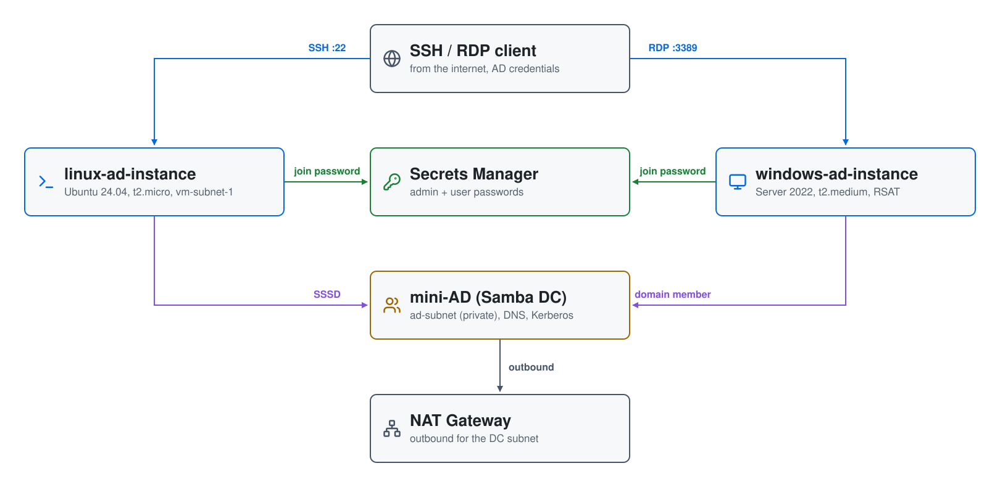
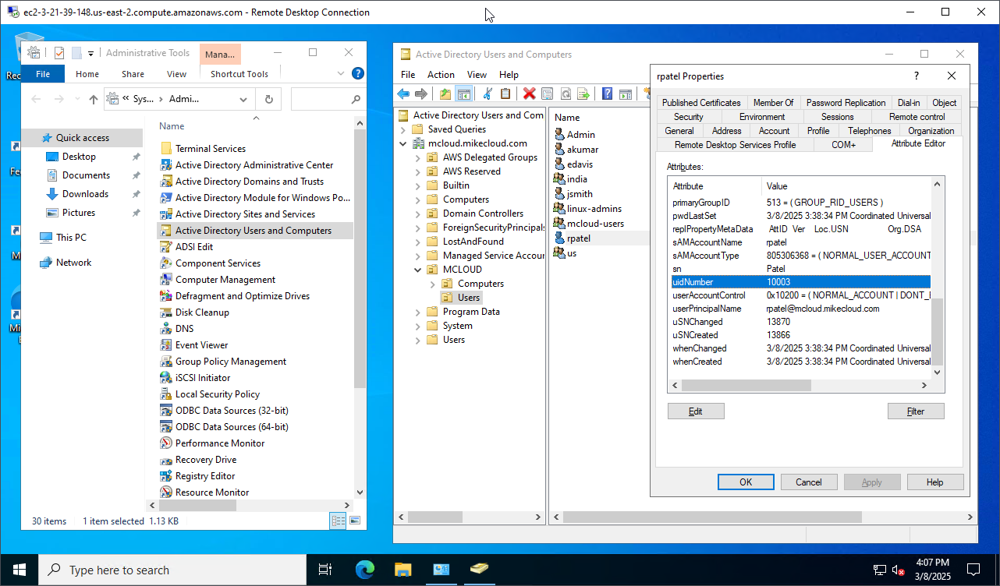
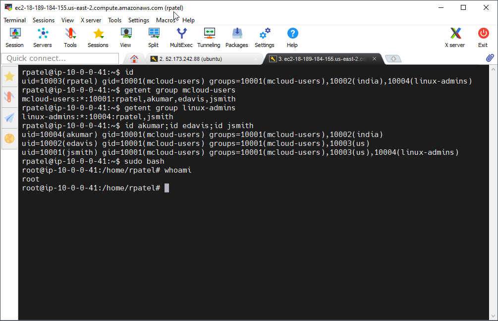

# Mini Active Directory on AWS

A small, fast, low-cost **Active Directory** domain for labs: a **Samba 4**
domain controller on one EC2 instance, built in minutes instead of the time
AWS Managed Microsoft AD takes, with a Linux and a Windows instance that join
the domain at boot. It's the follow-up to our
[AWS Managed Microsoft AD video](https://youtu.be/qUc5XQYTRSI), and the base
that the other mini-AD projects build on. Not for production.

| Piece | Where | Role |
|---|---|---|
| **mini-AD** (Samba DC) | `ad-subnet` (private) | domain `mcloud.mikecloud.com` / `MCLOUD`: users, groups, POSIX IDs, DNS, Kerberos; built by [`module-aws-mini-ad`](https://github.com/mamonaco1973/module-aws-mini-ad) |
| **linux-ad-instance** | `vm-subnet-1` | Ubuntu 24.04, `t2.micro`; joins with `realm` and SSSD; SSH with AD passwords |
| **windows-ad-instance** | `vm-subnet-1` | Windows Server 2022, `t2.medium`; joins the domain; RSAT for managing users |
| **Secrets Manager** | regional | `admin_ad_credentials` and `<user>_ad_credentials` |
| **NAT gateway** | public subnet | outbound internet for the DC's private subnet |

## Architecture

<picture>
  <source media="(prefers-color-scheme: dark)" srcset="architecture-dark.svg">
  
</picture>

Regenerate with `python3 make_diagram.py`.

- **`01-directory/`**: the VPC (`mini-ad-vpc`, 10.0.0.0/24) with two public
  VM subnets and the private `ad-subnet`, the NAT gateway, the AD passwords
  in Secrets Manager, and the DC, with users and POSIX attributes from
  `scripts/users.json.template`. DHCP points the VPC's DNS at the DC.
- **`02-servers/`**: the Linux and Windows instances, their IAM role (SSM
  plus read access to the admin secret), and security groups.

## How the members join

1. **Linux**: installs the SSM agent, the AWS CLI, SSSD and realmd, reads
   `admin_ad_credentials`, and joins with `realm join`. SSSD is set for short
   names (`jsmith`, not `jsmith@mcloud.mikecloud.com`) and the POSIX IDs
   stored in AD; SSH accepts passwords; home directories are created on
   first login; `linux-admins` get passwordless sudo. Logs:
   `/root/userdata.log` and `/root/join.log`.
2. **Windows**: installs RSAT, reads the same secret, joins with
   `Add-Computer`, adds `MCLOUD\mcloud-users` to Remote Desktop Users, and
   reboots.

| User | Groups | sudo on Linux |
|---|---|---|
| jsmith | mcloud-users, us, linux-admins, Domain Admins | yes |
| edavis | mcloud-users, us | no |
| rpatel | mcloud-users, india, linux-admins, Domain Admins | yes |
| akumar | mcloud-users, india | no |

| Group | gidNumber |
|---|---|
| mcloud-users | 10001 |
| us | 10002 |
| india | 10003 |
| linux-admins | 10004 |

## What mini-AD doesn't do

Compared with AWS Managed Microsoft AD, a single Samba DC on EC2 gives up:

- **Operations**: no second DC or multi-AZ, no automatic backups or
  patching, no AWS-managed hardening, support, or CloudWatch metrics.
- **Features**: no built-in integration with WorkSpaces, FSx, RDS SQL Server
  and other AWS services; limited GPO support without replication; no AD
  Web Services, so many AD PowerShell cmdlets don't work; trusts with an
  on-premises AD need manual setup.

## Security groups

```
internet ─22, 443─▶ linux-ad-instance
internet ─3389, 443─▶ windows-ad-instance
```

`ad-ssh-security-group`, `ad-rdp-security-group` and
`ad-ssm-security-group` allow those ports from `0.0.0.0/0`; every login still
needs an AD account. The DC has no public address. Both instances are also
reachable through **SSM Session Manager**.

## Prerequisites

* [An AWS Account](https://aws.amazon.com/console/)
* [Install AWS CLI](https://docs.aws.amazon.com/cli/latest/userguide/getting-started-install.html)
* [Install Terraform](https://developer.hashicorp.com/terraform/install)
* [Install jq](https://jqlang.github.io/jq/download/)

If this is your first time watching our content, we recommend starting with
this video: [AWS + Terraform: Easy Setup](https://youtu.be/BCMQo0CB9wk).

## Deploy

```bash
git clone https://github.com/mamonaco1973/aws-mini-ad.git
cd aws-mini-ad
./apply.sh       # 1: VPC + mini-AD + secrets  2: Linux and Windows instances
```

Everything deploys to `us-east-1`. After `apply.sh` finishes, the Linux
instance needs a few minutes to join the domain, and the Windows instance
longer, because it joins and then reboots. `apply.sh` ends by running
`validate.sh`:

```
============================================================================
Mini-AD Quick Start - Validation Output
============================================================================

NOTE: Windows RDP Host FQDN: ec2-203-0-113-10.compute-1.amazonaws.com
NOTE: Linux SSH Host FQDN:  ec2-203-0-113-20.compute-1.amazonaws.com

NOTE: Validation complete.
```

## Try it

1. Get a user's password:

   ```bash
   aws secretsmanager get-secret-value --secret-id jsmith_ad_credentials \
     --query SecretString --output text | jq -r .password
   ```

2. RDP to the **Windows RDP Host** as `MCLOUD\jsmith`. **Active Directory
   Users and Computers** is installed.

   

3. SSH to the **Linux SSH Host** as `jsmith`. Try `id`,
   `getent group linux-admins` and `sudo -l`.

   

## Troubleshooting

| Symptom | Fix |
|---|---|
| SSH rejects every AD password | The Linux instance hasn't finished joining. `aws ssm start-session --target <instance-id>`, then `sudo tail /root/userdata.log /root/join.log`. |
| RDP rejects `MCLOUD\jsmith` | The Windows instance joins and then reboots; give it several minutes. |
| `id <user>` finds nothing | The user needs `uidNumber`, `gidNumber` and `uid` set in AD. SSSD caches lookups; `sudo sss_cache -E` clears it. |

## Teardown

```bash
./destroy.sh     # destroys the instances, deletes the AD secrets, destroys the DC and VPC
```

## Notes

- **Lab only.** SSH and RDP are open to the internet, jsmith and rpatel are
  Domain Admins, and the join uses the domain admin account. Restrict the
  security groups and use a dedicated join account for anything more.
